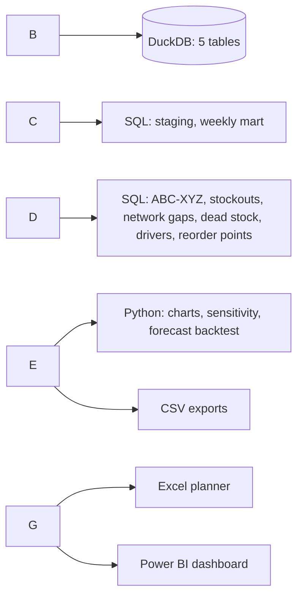

# Where Are We Losing Sales? Inventory Health \& Replenishment Analysis

!\[Python](https://img.shields.io/badge/Python-pandas%20%C2%B7%20matplotlib-2A78D6) !\[SQL](https://img.shields.io/badge/SQL-DuckDB%20%C2%B7%20window%20functions-2A78D6) !\[Excel](https://img.shields.io/badge/Excel-planner%20model-2A78D6) !\[Power BI](https://img.shields.io/badge/Power%20BI-DAX%20%C2%B7%20star%20schema-2A78D6)

An end-to-end analysis of **two years of daily Walmart sales** (11.8 million rows, Kaggle M5 data) for 1,612 household and hobby products in 10 stores. It finds where sales are lost to empty shelves, which lines are dead weight, and when each top seller should be reordered. The output is a Power BI dashboard for managers and an Excel planner for the people who place orders.

## Results at a glance (last 52 weeks)

* **$360K of sales lost to likely stockouts**, 1.8% of revenue, across 6,642 gaps in 2,799 item-store lines. This is a conservative estimate: a ten-times stricter test still keeps $291K.
* **A third of the loss (34%, $121K) came from "network gaps"**: the same item out in 3 or more stores at once. That points to the supplier or the warehouse, not to store ordering.
* **CA\_3, the busiest store, loses the most:** 2.6% of its revenue, against 1.8% for the chain. In its Household 1 department alone, the loss is $64K.
* **The loss is spread, not concentrated.** The 50 costliest gaps hold only 10% of it, so the fix is a system (reorder points and a weekly exception list), not firefighting.
* **Variable top sellers suffer most.** A-items with erratic demand (AZ) lose 4.0% of their revenue, against 1.3% for steady ones (AX). A 4-week moving-average forecast is out by 28% on steady lines and 71% on erratic ones.

!\[34% of lost sales come from gaps that hit 3+ stores at once](images/03\_network\_gaps.png)

## Business question

A mass retailer's planning team reviews stock weekly from raw exports. Gaps are noticed only when customers complain, and slow lines keep their shelf space. This project answers four questions:

1. Where, and how much, are we losing to empty shelves?
2. Is each gap a store problem or a supply problem?
3. Which lines matter most, and which are dead weight?
4. When should each top seller be reordered?

The same approach fits Malaysian home-improvement and pharmacy chains, where peaks such as Hari Raya, 11.11 and year-end sales stretch replenishment.

## Key findings

**1. Lost sales vary almost threefold between stores.** CA\_3 loses 2.6% of revenue to likely stockouts; CA\_4 loses 0.9%. Household 1 is the weakest department (2.3%) and holds 69% of all lost revenue.

!\[Lost sales by store](images/02\_lost\_sales\_by\_store.png)

**2. A third of the loss is a supply problem.** 1,887 gaps (28%) hit three or more stores at the same time, and they carry 34% of lost revenue. In the costliest case, one household item went to zero in **all 10 stores in three states** for about two weeks from late August 2015 ($7,233 lost). No single store's ordering looks like that.

!\[One item, ten stores, the same empty fortnight](images/04\_stockout\_example.png)

**3. 38% of lines bring 80% of revenue, and their predictability decides the plan.** Steady A-items (AX) hold half of all revenue and are easy to automate. 3,720 erratic C-lines (CZ, 23% of the range) bring only 3% of revenue: candidates for delisting or order-on-demand. 27 lines are dead (no sales in 26 weeks, still listed) and 305 are slow.

!\[ABC-XYZ matrix](images/05\_abc\_xyz\_matrix.png)

**4. Forecast error triples from steady to erratic lines.** In a 13-week backtest, a 4-week moving average beats both naive methods but its error (WAPE) rises from 28% on X lines to 71% on Z lines. Z lines need buffer stock and human review, not blind automation.

!\[Forecast error by XYZ class](images/06\_forecast\_error.png)

**5. Demand spikes are predictable.** Halloween lifts Hobbies 2 sales by 67% and Labor Day lifts Household by 23–26%, so those weeks need stock built ahead. SNAP payment days barely move these non-food ranges (0–4%).

## Recommendations

|#|Action|Owner|Size of the prize (this sample, per year)|
|-|-|-|-|
|1|Alert the buyer within 48 hours when an item goes to zero in 3+ stores, and escalate to the supplier|Buyer, supply planning|$121K of losses come from these gaps|
|2|Review CA\_3 replenishment first: order frequency and shelf capacity for Household 1|Store operations, planning|About $28K if CA\_3 matched the chain average|
|3|Set variability-based reorder points for all 6,168 A-item lines, starting with AY and AZ|Inventory planning|About $100K if AY and AZ lost no more than AX does|
|4|Work a weekly exception list: on the last day of data, 47 lines were out of stock, losing about $277 a day|Inventory planning|Catches gaps that now last 9 days on average|
|5|Clear 27 dead lines and review 305 slow ones; move CZ lines to order-on-demand|Category management|Frees shelf space and cash|

These figures overlap (a network gap can also be an AY line), so they are not added together. The full memo is in [docs/recommendation\_memo.md](docs/recommendation_memo.md).

## What each tool does

|Tool|What I did|Files|
|-|-|-|
|**Python** (pandas, matplotlib)|Reshaped 16,120 series from wide to long, ran quality checks, tested the stockout rule's sensitivity, backtested three forecasting methods and drew the charts|`notebooks/01\\\_data\\\_preparation.ipynb`, `notebooks/03\\\_insights.ipynb`|
|**SQL** (DuckDB)|Built the whole analysis in ten scripts: staging views, a weekly mart, ABC–XYZ with window functions, gaps-and-islands stockout detection, a self-join for network gaps, reorder points|`sql/01` to `sql/10`, run by `notebooks/02\\\_sql\\\_analysis.ipynb`|
|**Excel**|A replenishment planner: dependent drop-downs, INDEX/MATCH lookups, NORMSINV safety stock, a what-if grid, SUMIFS and COUNTIFS summaries, conditional formatting and charts|`excel/Inventory\\\_Replenishment\\\_Planner.xlsx`|
|**Power BI**|A three-page dashboard on a star schema with 17 DAX measures, including year-on-year growth with DATESINPERIOD|`powerbi/InventoryHealth.pbip`|
|**Business analysis**|Problem statement, stakeholders, RACI, KPI definitions, user stories with acceptance criteria, as-is and to-be process maps, assumptions log|`docs/ba\\\_pack.md`|

### Excel replenishment planner

Pick a store and an item, enter the lead time, service level and stock on hand, and the planner returns the reorder point, the decision and the order quantity. Every number is a live formula.

!\[Excel planner](images/08\_excel\_planner.png)

!\[Excel summary sheet](images/07\_excel\_summary.png)

### Power BI dashboard

Three pages: **Overview** (KPIs, trend, lost sales by store and by number of stores out), **Range health** (ABC–XYZ, slow and dead lines) and **Stockouts \& reorder** (watchlist, reorder points with a lead-time slicer). How to open and refresh it: [powerbi/README.md](powerbi/README.md).

!\\\[Power BI overview](images/powerbi\\\_overview.png)
!\\\[Power BI range health](images/powerbi\\\_range\\\_health.png)
!\\\[Power BI stockouts and reorder](images/powerbi\\\_stockouts.png)

## Data

\* \*\*Source:\*\* \[M5 Forecasting – Accuracy](https://www.kaggle.com/c/m5-forecasting-accuracy/data) (Walmart, via Kaggle): daily unit sales of 3,049 products in 10 stores in California, Texas and Wisconsin, January 2011 to May 2016, with weekly shelf prices and an events calendar.
\* \*\*Scope:\*\* Household and Hobbies (the non-food ranges), the last 730 days (24 May 2014 to 22 May 2016): 16,120 item-store lines and 11,767,600 rows.
\* \*\*Quality checks\*\* (`sql/02\\\_quality\\\_checks.sql`): no duplicate keys, nulls, negative values or missing days. 1.4% of item-store days had no shelf price (item not listed), and 67% of listed days had zero sales. 21 store-days were flagged as closed (Christmas Day in both years at every store, plus a near-shutdown at TX\\\_2 on 24 March 2015) and excluded, so they were never mistaken for stockouts.

## Method



\*\*How a stockout is inferred.\*\* The data has no stock-on-hand, so a gap is a run of zero-sale days while the item is listed and the store is open. If the item normally sells λ units a day (its average over the previous 8 weeks), the chance of L zero days in a row while in stock is e^(−λL). A run counts as a likely stockout when that chance is below 1 in 100,000. The bar is strict because every gap in two years is tested, and a 1% bar would flag thousands by chance. Gaps over 28 days are kept out of the totals as possible range changes. Lost units are λ × L, valued at the shelf price.

|Chance bar|Likely stockouts|Est. lost revenue|vs chosen bar|
|-|-|-|-|
|1 in 1,000|18,896|$695,546|193%|
|1 in 10,000|10,384|$468,315|130%|
|\*\*1 in 100,000 (used)\*\*|\*\*6,642\*\*|\*\*$359,976\*\*|\*\*100%\*\*|
|1 in 1,000,000|4,563|$291,350|81%|

\*\*Reorder point\*\* = average daily demand × lead time + z × standard deviation of daily demand × √lead time, with z = 1.65 for a 95% service level. Demand statistics leave out days inside likely stockouts, because an empty shelf records zero sales and would understate demand.

\*\*Tested on known answers.\*\* `tests/test\\\_sql\\\_logic.py` builds synthetic sales with planted problems (a 10-day gap, a gap in three stores at once, a closed day, a slow seller, a dead line) and checks that the SQL finds each one, with no false alarms. All 11 checks pass.

## Assumptions and limitations

\* No stock-on-hand, cost, promotion or supplier lead-time data. Stockouts are inferred, lost sales are estimates, and lead times are scenarios (3, 7 and 14 days, or any value in the Excel planner).
\* Sales are assumed to follow a Poisson pattern around an 8-week baseline. The baseline does not adjust for weekday or event effects; the strict bar keeps this conservative.
\* 2,635 gaps over 28 days in the last year (up to $845K if they were all stockouts) are excluded as possible range changes. They need a check with category managers.
\* Full assumptions log: \[docs/ba\\\_pack.md](docs/ba\_pack.md#6-assumptions-log).

## How to reproduce

```bash
git clone https://github.com/Farah-Annisa/inventory-health-analysis.git
cd inventory-health-analysis
pip install -r requirements.txt
```

1. On Kaggle, accept the [M5 competition rules](https://www.kaggle.com/c/m5-forecasting-accuracy/rules), download the data and put `sales\\\_train\\\_evaluation.csv`, `calendar.csv` and `sell\\\_prices.csv` in `data/raw/`.
2. Run the notebooks in order: `01\\\_data\\\_preparation` (about 15 seconds), `02\\\_sql\\\_analysis` (about 40 seconds) and `03\\\_insights` (about 2 minutes).
3. Optional: `python tests/test\\\_sql\\\_logic.py`.

The Excel planner and the Power BI dashboard read the CSV files in `data/processed/`, which are included, so they work without re-running anything.

## Repository

```
├── notebooks/   01 data preparation · 02 SQL analysis · 03 insights and charts
├── sql/         ten DuckDB SQL scripts, run in order
├── excel/       Inventory\\\_Replenishment\\\_Planner.xlsx
├── powerbi/     InventoryHealth.pbip (model + report as text), measures.dax, guides
├── data/        raw/ (not included) · processed/ (aggregated tables for Excel and Power BI)
├── images/      charts and screenshots used in this README
├── docs/        BA pack, recommendation memo, data dictionary, user guide
└── tests/       SQL logic tests on synthetic data
```

## AI use

I used an AI assistant to help draft code and documentation. I ran every step on the real data, checked the outputs and can explain each method and number.

## Author

**Farah Norhisham** · [LinkedIn](https://www.linkedin.com/in/farahannisa-norhisham) · [GitHub](https://github.com/Farah-Annisa)

Code is MIT-licensed. The raw M5 data is not included in this repository and is subject to the Kaggle competition rules; `data/processed/` holds aggregated outputs only.

