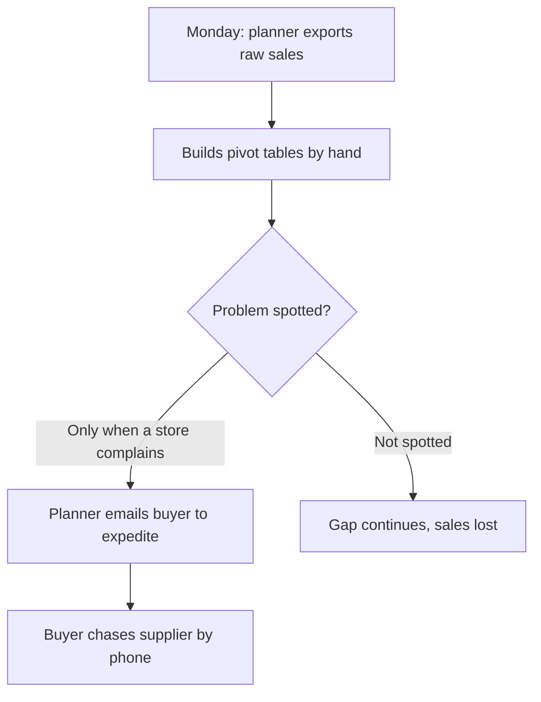
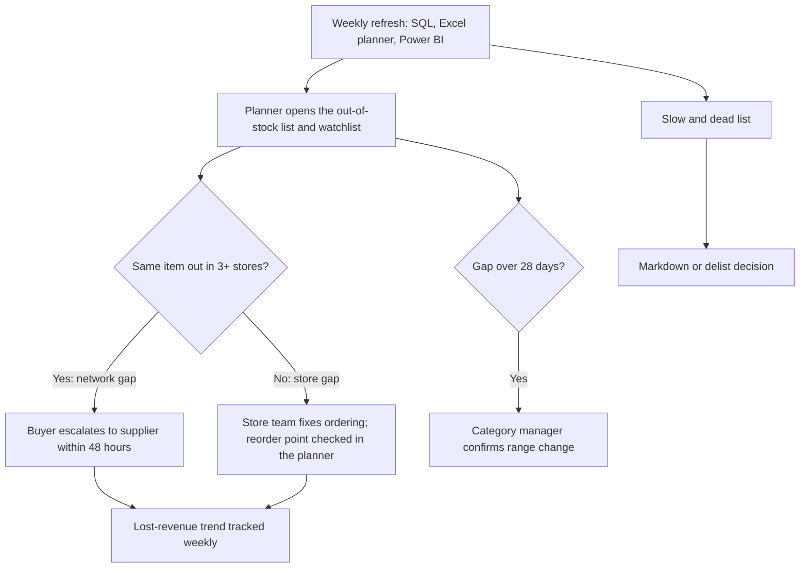

# BA pack: inventory health and replenishment review

*Self-directed portfolio project on public Walmart data (Kaggle M5). Stakeholders and the as-is process are realistic stand-ins for a mass retailer; the assumptions log says what a real team would need to confirm.*

## 1. Problem statement

**Context.** A mass retailer sells 1,612 household and hobby lines across 10 stores in three states. Planners review stock weekly from raw sales exports, with no shared view of gaps, dead lines or reorder levels.

**Problem.** Lines run out without anyone noticing until customers complain, while slow lines keep their shelf space. Neither cost is measured.

**Goal.** One weekly view that (1) flags likely stockouts and values them, (2) separates store problems from supply problems, (3) lists slow and dead lines, and (4) sets reorder points for the lines that matter most.

| | |
|---|---|
| **In scope** | Household and Hobbies; 10 stores; last two years of daily sales; weekly shelf prices; event and SNAP calendar |
| **Out of scope** | Foods; stock-on-hand, costs and supplier lead times (not in the data); promotions; automated ordering |
| **Success measures** | A planner finds this week's top 20 stockout risks in under 2 minutes; lost sales tracked weekly; every A-item has a reorder point for a stated lead time |

**What the analysis found** (last 52 weeks): $360K of sales lost to 6,642 likely stockouts (1.8% of revenue); 34% of that loss came from gaps hitting 3+ stores at once; CA_3 loses 2.6% against a 1.8% chain average; 27 dead and 305 slow lines.

## 2. Stakeholders

| Stakeholder | Interest | Needs from this work | Influence |
|---|---|---|---|
| Inventory planning manager | Availability versus stock cost | Stockout watchlist, reorder points | High (decision owner) |
| Buyer / procurement | Supplier orders | Network-gap alerts, reorder points, event pre-build | High |
| Store operations manager | Shelf availability | Lost sales by store, out-of-stock list | Medium |
| Category manager | Range performance | ABC–XYZ, dead and slow lines | Medium |
| Finance | Working capital | Lost-sales estimate, dead-stock list | Medium |
| BI / data team | Data quality and refresh | SQL scripts, data dictionary | Medium |

### RACI: weekly replenishment review

R = does the work · A = accountable · C = consulted · I = informed

| Activity | Planning manager | Analyst | Buyer | Store ops | BI lead |
|---|---|---|---|---|---|
| Refresh data, planner and dashboard | I | R | – | – | A |
| Review stockout watchlist and out-of-stock list | A | R | C | I | – |
| Escalate network gaps to suppliers | I | C | A, R | I | – |
| Adjust reorder points | A | R | C | – | – |
| Markdown or delist dead lines | A | R | C | C | – |

## 3. KPI definitions

| KPI | Definition | Rule or formula | Source | Decision it supports |
|---|---|---|---|---|
| Revenue, 52 weeks | Sales value over the last 52 full weeks | SUM(units × shelf price) | `abc_xyz` | Context; ABC thresholds |
| Likely stockouts | Zero-sale runs that are near-impossible if in stock | Poisson chance < 1 in 100,000; 28 days or shorter | `stockout_runs` | Which lines to expedite |
| Estimated lost revenue | Sales missed during likely stockouts | Baseline daily units × days out × shelf price | `stockout_runs` | Rank fixes by value |
| Lost revenue % | Size of the problem relative to sales | Lost revenue ÷ revenue | DAX `[Lost revenue %]` | Compare stores and departments |
| Network gap share | Share of loss from supply-side gaps | Lost revenue in gaps with 3+ stores out ÷ all lost revenue | `stockout_network` | Store fix or supplier fix |
| Out of stock now | Gaps still open on the last day | ongoing_at_data_end = true | `dash_stockouts_52w` | This week's action list |
| Dead / slow lines | Listed with no sales in 26 weeks / 2 or fewer units in 13 weeks | units_26w = 0 / units_13w ≤ 2 | `slow_dead_stock` | Markdown or delist |
| Reorder point | Stock level that triggers an order | d̄ × L + z × σd × √L | `reorder_points`, Excel planner | When to order |
| Forecast error (WAPE) | Accuracy of a simple forecast | Σ\|forecast − actual\| ÷ Σ actual | Notebook 03 | Where to automate |
| Event uplift | Demand change versus a normal same weekday | units ÷ normal units − 1 | `demand_drivers` | How much to pre-build |

## 4. User stories and acceptance criteria

**US1 · Stockout watchlist.** As an inventory planner, I want likely stockouts ranked by lost revenue, so that I fix the most expensive gaps first.
- Given the dashboard is refreshed, when I open *Stockouts & reorder*, then I see the last 52 weeks' likely stockouts sorted by estimated lost revenue.
- When I pick one store in the slicer, then the table and totals show only that store.
- Each row shows store, item, segment, start date, days out, normal daily units, estimated lost revenue and stores out together.

**US2 · Size of the problem.** As a planning manager, I want total lost revenue from stockouts, so that I can size the problem for leadership.
- Given *Overview*, then cards show estimated lost revenue, its share of sales and the number of likely stockouts.
- The definition of a likely stockout is written on the dashboard and in the user guide.

**US3 · Store or supply problem.** As a buyer, I want gaps that hit several stores at once flagged, so that I can chase the supplier instead of the stores.
- Given *Overview*, then a chart shows lost revenue by the number of stores out at the same time.
- Given the watchlist, then each gap shows how many stores were out of that item together, and a slicer isolates network gaps (3+ stores).

**US4 · Reorder points.** As a buyer, I want reorder points for A-items under different lead times, so that I can set order triggers.
- Given *Stockouts & reorder*, when I choose a lead time of 3, 7 or 14 days, then each A-item shows its reorder point and safety stock.
- Given the Excel planner, when I enter any lead time, service level and stock on hand, then it shows the reorder point, the decision and the order quantity.

**US5 · Dead and slow lines.** As a category manager, I want dead and slow lines listed, so that I can plan markdowns and free shelf space.
- Given *Range health*, then each line is labelled Dead or Slow, with units in the last 13 weeks and days since the last sale.

**US6 · Event pre-build.** As a buyer, I want demand uplift by event and department, so that I can build stock before peaks.
- Given `demand_drivers`, then each event shows its average uplift versus a normal same weekday, by department.

**US7 · Rebuildable.** As a BI analyst, I want documented tables and run steps, so that anyone can refresh the outputs.
- Given the repository, then the data dictionary lists every output table, and the README lists the run order and expected run times.

## 5. Process: weekly replenishment review

### As-is

Pain points: manual pivots every week; gaps found by complaint; no value on a gap; no way to tell a store problem from a supply problem; dead lines never reviewed.

### To-be

## 6. Assumptions log

| ID | Assumption | Why it matters | Status | How to validate |
|---|---|---|---|---|
| A1 | A shelf price in a week means the item was listed in that store | Defines "listed" | Accepted | Compare with range lists |
| A2 | Daily sales follow a Poisson pattern around the 8-week baseline | Drives stockout flags | Accepted; sensitivity tested | Compare flags with stock records |
| A3 | Gaps over 28 days are range changes, not stockouts | Keeps lost sales conservative ($845K of long gaps excluded) | Open | Ask category managers |
| A4 | Lead time is 3, 7 or 14 days | Drives reorder points | Open: shown as scenarios | Supplier lead-time data |
| A5 | Target service level is 95% (z = 1.65) | Drives safety stock | Open: adjustable in Excel | Agree with planning manager |
| A6 | Store sales under 10% of normal mean the store was shut | Stops Christmas looking like a stockout | Accepted | Store calendars |
| A7 | No promotions data; price changes taken as given | Baselines may include promotion effects | Accepted | Add a promotion calendar |
| A8 | 3+ stores out of the same item at once points upstream | Routes gaps to buyers, not stores | Accepted | Check with supplier fill-rate data |
| A9 | Days inside likely stockouts are left out of demand statistics | Stops empty shelves understating demand | Accepted | Compare with stock records |

## 7. Traceability

| Story | KPI | Table | Where it appears |
|---|---|---|---|
| US1 | Likely stockouts; lost revenue | `dash_stockouts_52w` | Power BI · Stockouts & reorder; Excel · Watchlist |
| US2 | Lost revenue; lost revenue % | `dash_kpis` | Power BI · Overview; Excel · Summary |
| US3 | Network gap share | `stockout_network` | Power BI · Overview and watchlist |
| US4 | Reorder point | `reorder_points` | Power BI · Stockouts & reorder; Excel · Planner |
| US5 | Dead and slow lines | `dash_slow_dead` | Power BI · Range health; Excel · Range review |
| US6 | Event uplift | `demand_drivers` | Notebook 03; Power BI model |
| US7 | – | all tables | README, data dictionary |
