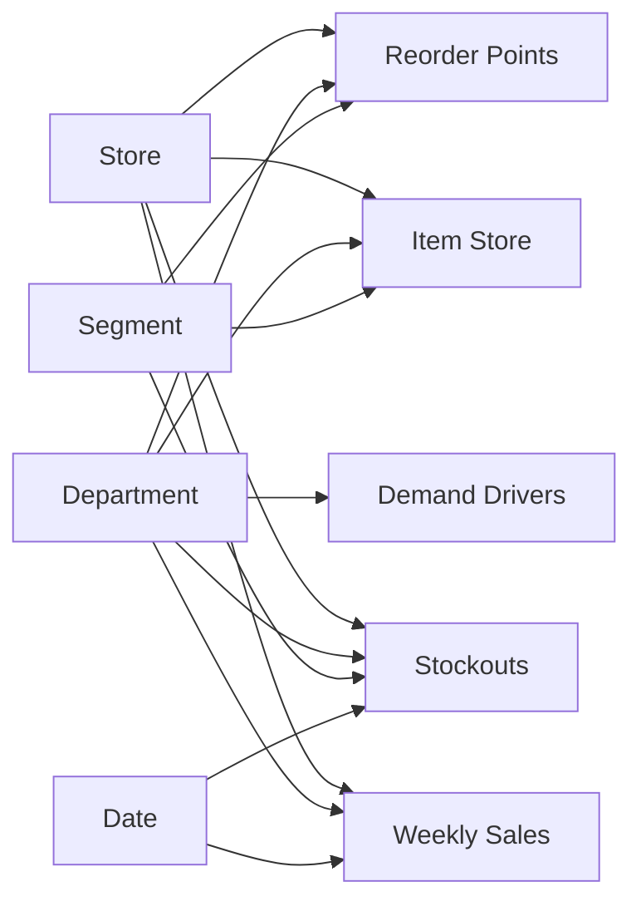

# Power BI dashboard

`InventoryHealth.pbip` is a Power BI project: the model (tables, relationships and 17 DAX measures in TMDL) and the three report pages (PBIR) are plain text files, so every change shows up in Git. It reads the small CSV files in `data/processed/`, about 5 MB in total, so it runs comfortably on an 8 GB laptop.

| Page | What it answers | Main visuals |
|---|---|---|
| **Overview** | How much are we losing to empty shelves, and where? | 6 KPI cards · weekly revenue by category · lost % by store and department · lost revenue by number of stores out at once |
| **Range health** | Which lines matter, and which are dead weight? | ABC–XYZ matrix · planning rule per segment · slow and dead lines |
| **Stockouts & reorder** | Which gaps to fix first, and when to reorder? | Stockout watchlist · lost % by segment · reorder points with a lead-time slicer |

## Open it (about 10 minutes)

1. Install **Power BI Desktop** from the Microsoft Store (free, Windows only).
2. Put the repository folder at `C:\inventory-health-analysis` (rename it if GitHub's download added `-main`), so the data path works as is.
   If it lives somewhere else: after opening, go to **Home → Transform data → Edit parameters** and set `DataFolder` to your `data\processed\` folder.
3. Double-click `powerbi\InventoryHealth.pbip`.
4. Click **Home → Refresh**. If Power BI asks about privacy levels, choose **Ignore privacy levels** (all data is local CSV).
5. Check that the Overview cards match the analysis:

   | Card | Expected value |
   |---|---|
   | Revenue (52w) | $19,929,074 |
   | Lost revenue (est.) | $359,976 |
   | Lost revenue % | 1.81% |
   | Likely stockouts | 6,642 |
   | Network gap share | 33.5% |
   | Out of stock now | 47 |

6. Optional: **File → Save as** `InventoryHealth.pbix` to share a single file, and **File → Export → PDF** for a static copy.
7. Take three screenshots (Windows + Shift + S), save them as `images/powerbi_overview.png`, `images/powerbi_range_health.png` and `images/powerbi_stockouts.png`, then remove the comment markers around the Power BI images in the main README.

## Model

Star schema: four dimensions and five fact tables, all relationships one-to-many and single-direction.

| Table | Rows | Source CSV | Grain |
|---|---|---|---|
| Store | 10 | `dim_store.csv` | store |
| Department | 4 | `dim_item.csv` (distinct departments, built in Power Query) | department |
| Segment | 9 | `abc_xyz_matrix.csv` | ABC–XYZ segment, with its planning rule |
| Date | 730 | `dim_date.csv` | day (marked as the date table) |
| Item Store | 16,120 | `dash_item_store_summary.csv` | item × store |
| Stockouts | 6,642 | `dash_stockouts_52w.csv` | likely stockout run, last 52 weeks |
| Weekly Sales | 4,160 | `dash_weekly_sales.csv` | store × department × week |
| Reorder Points | 18,504 | `reorder_points.csv` | A-item × store × lead time |
| Demand Drivers | 124 | `demand_drivers.csv` | event or SNAP day × department |

All measures sit in the **Key Measures** table; `measures.dax` lists them in one readable file. Implicit measures are switched off, so every number on the report comes from a named, documented measure.

## If the project does not open

The project files were checked against Microsoft's published PBIR schemas and the model was parsed with Microsoft's Tabular Object Model, but they were not opened in Power BI Desktop itself. If your version shows an error:

- update Power BI Desktop (PBIP and PBIR are standard from the September 2026 release), then try again;
- or build the report by hand from the same CSVs with [BUILD_MANUALLY.md](BUILD_MANUALLY.md) (about 45 minutes).
